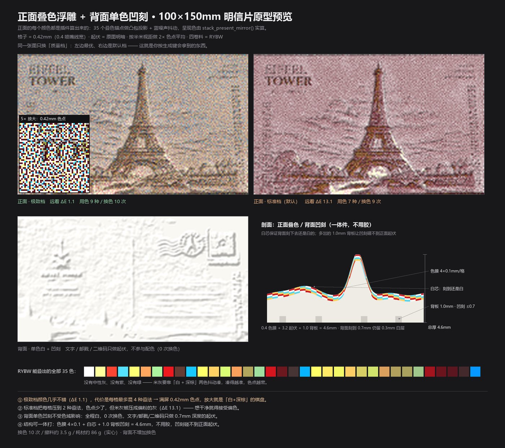
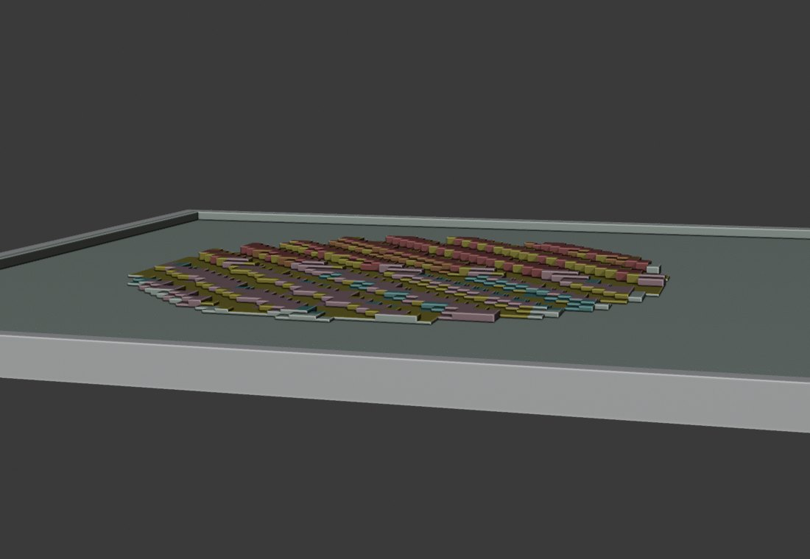
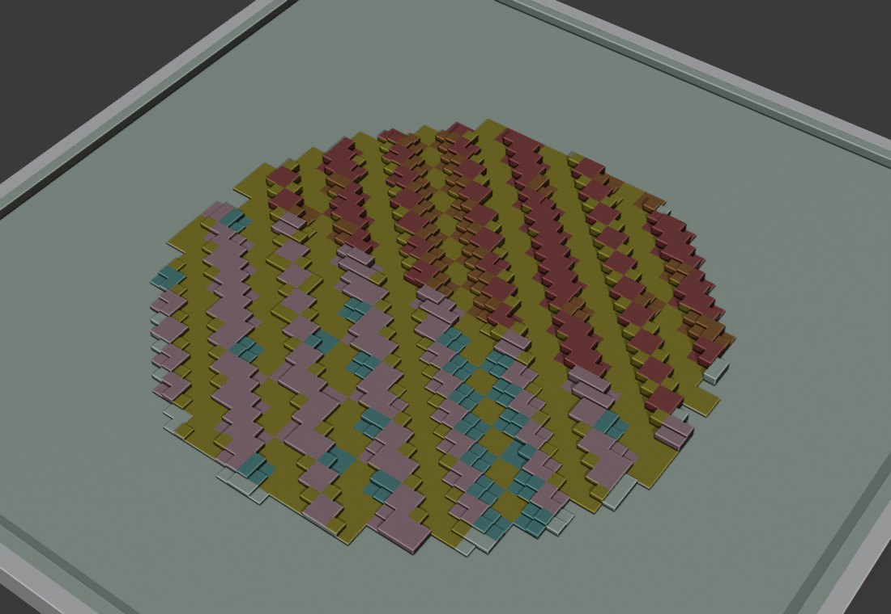

# 叠色浮雕工坊 · ColorStack Relief

**把一张照片，变成用四卷耗材打印出来的彩色浮雕。**

> Blender 扩展 · GPL-3.0-or-later · 需要 Blender 4.2+（实测 5.1.2）· 当前版本 **v1.0.17**

> License: GPL-3.0-or-later © 2026 barry。详见仓库根目录 `LICENSE`。

普通 FDM 打印机一次只能挤一种颜色。这个插件不靠多喷头、也不靠换色塔，
而是让**同一位置的多层 0.1mm 薄片叠加**、靠透光混出中间色 ——
和拓竹切片器里的「分层混色」是同一个原理，区别在于这里把**几何、材质分配、
3MF 工程**一起算好了，拓竹打开即用，不用对着换色表手工设。



## 它能做什么

| 模式 | 形态 | 适合 |
|---|---|---|
| 全色平板 `mosaic` | 色块平打、全彩 | 徽章、冰箱贴、色块画 |
| 叠色浮雕 `relief` | 照片起伏 + 叠色 | 风景照、人像、纪念牌 |
| 明信片浮雕 `postcard` | 正面叠色浮雕 + 反面单色凹刻（文字/邮戳/二维码） | 旅行明信片、伴手礼 |
| 双面平板 `card` | 双面板、厚度固定 0.8mm | 卡片、书签 |
| 单面平板 `single` | 正面 8 层彩膜（整块叠色、不撒点）+ 0.40mm 白底板（正好 4 层白），反面纯白，约 1.2mm | 只看一面的照片卡、冰箱贴（色阶是 4 层方案的四倍） |

除了上面五种形态，插件还把这些活一起干完了：

- **12 档分辨率**（长边 32 → 1440 格）—— 档位越高细节越多，耗时与内存也越多；机器吃不消只会提示，不会偷偷降档
- **四档色组**：CMYK 四色 / RYBW 四色 / CMYWGK 六色 / 8 色 MAX —— 选哪档就直接决定你要买哪几卷耗材
- **导出即带材质**：3MF 里已写好耗材映射，拓竹打开就能切片；OBJ 会附带 `.mtl`
- **底板单独成对象** —— 切片器里能给底板单独换料（比如换白或换黑），不用手工拆模型
- **挂绳孔 / 挂环**：内置通孔或外挂环，位置与孔径可调
- **外框按层数加宽**（0~5 层，每层 0.40mm），成品尺寸随加随算
- **明信片反面凹刻**：文字、邮戳、二维码都能刻进背板，一体件不用胶
- **中英双语界面**，生成过程在状态栏显示进度条与当前阶段



## 快速开始

**① 装插件**

1. 到 [Releases](releases) 下载最新 `ColorStackRelief_vX.Y.Z.zip`（**不用解压**）
   > Release 的附件名只能用英文（实测中文会被截掉），所以这里叫 `ColorStackRelief_…`；
   > 本地打出来的 `叠色浮雕工坊_…zip` 与它内容完全相同，装哪个都一样。
2. Blender → `编辑` → `偏好设置` → `扩展` → 右上角下拉箭头 → `从磁盘安装…`
3. 选中 zip，勾上「叠色浮雕」启用
4. **装完或升级后完全退出 Blender 再打开** —— 不重启会继续跑内存里的旧版逻辑

> 插件会自动侦测这种残留：面板顶部出现红色「运行的仍是旧版」警告时，重启即可。

**② 出模型**

1. **选图片** —— 3D 视图按 `N` → 「叠色浮雕」标签 → 选文件 → **载入图片**
2. **设参数** —— 选模式 / 分辨率（1~12 档）/ 最长边尺寸；选混色色组（决定你要买哪几卷料）
3. **生成并导出** —— 「生成模型」（窗口底部状态栏会显示进度条与当前阶段）→ 「导出 3MF」，拓竹里已带四色材质与耗材映射



## 打印前必读

- **切片层高必须 ≤ 0.1mm。** 高了切片器会把色膜两两合并成一层，混色直接消失：
  单面模式是 8 片，层高 0.2mm 时每两层材质被并进同一个切片层、只能取其一，
  实际就只剩 4 层色阶 —— 颜色变淡、色阶断层。切片前请确认层高 = 0.1mm。
- **四色没有黑墨。** 深色/暗部只能靠几何阴影表现，还原上限由耗材决定 ——
  这是物理约束，不是调参能解决的（具体数值见下面第一节）。
- 柱宽（一格像素打印出来有多宽）随「分辨率」和「最长边尺寸」自动换算，统一按
  **0.4mm 喷嘴（线宽 0.42mm）**折最小可打印尺寸。面板不再让你选喷嘴档位 ——
  v1.0.14 起只留档位、不再让你选喷嘴 —— 1~12 档，第 4 档（默认）= 96 格，
  第 10 档 = 720 格，第 11 档 = 1000 格，第 12 档 = 1440 格。
  **11、12 档按该档格数直接生成**：内存不足也不降档、不提示。

## 仓库里有什么

| 目录 | 内容 |
|---|---|
| `ColorStackRelief/` | 插件本体（`core/` 是纯算法 + 几何 + 导出，不依赖 UI） |
| `docs/images/` | README 配图 |

参数逐项说明、五种形态细节、拓竹里的用法、故障排查，都在下面正文（一～九）。
版本变更见 [CHANGELOG.md](CHANGELOG.md)。

## 许可

插件代码以 **GPL-3.0-or-later** 发布，全文见 [LICENSE](LICENSE)。

**第三方内容**：`ColorStackRelief/resources/bambu_a1_template.json` 是从
Bambu Studio 导出的打印工艺预设快照，随包分发是为了让 3MF 打开就带工艺参数。
Bambu Studio 以 **AGPL-3.0** 授权，该文件仍受 AGPL-3.0 约束；AGPL v3 第 13 条
允许它与 GPLv3 作品组合分发，其余代码仍是 GPL-3.0-or-later。
来源与许可见 [THIRD-PARTY-NOTICES.md](THIRD-PARTY-NOTICES.md)。

**非官方项目**：本项目是个人作品，与 Bambu Lab / 拓竹科技没有隶属、赞助或背书关系。
「Bambu」「Bambu Lab」「Bambu Studio」「拓竹」是其各自所有者的商标，
此处仅用于说明文件格式与打印流程的兼容性。

---

## 一、它解决什么问题

一张普通照片有上千万种颜色，但 FDM 打印机一次只能挤一种耗材。所以「逐像素自由混色」在物理上不可能 —— 必须换思路。

核心思路：**先算清楚"这四种线材到底能叠出哪些颜色"，再把目标色投影上去。**

### 四色能叠出的颜色 = 一个四面体

把白、青、品红、黄四种线材的颜色看成颜色空间里的 4 个点。任意按比例混合它们（比如青 19% + 品红 19% + 黄 23% + 白 38%），得到的颜色一定落在这 4 个点张成的**四面体**内部；反过来，四面体内部的每一个点都对应一种确切的叠加比例。

所以配色问题在数学上就是一句话：**把目标色投影到这个四面体上，取最近点的重心坐标作为叠加比例。**

- 目标色在四面体**内部** → 精确还原，色差为 0
- 目标色在四面体**外部**（主要是深色） → 落到最近的面上，这是耗材的物理极限，不是算法问题

实测（标定阶段 14 项断言全通过）：

| 目标色 | 还原结果（叠加比例） | 色差 | 说明 |
|---|---|---|---|
| 浅灰 (0.81, 0.81, 0.77) | 青 19% + 品红 19% + 黄 23% + 白 38% | **0.0000** | 精确还原 |
| 浅粉 (1.0, 0.8, 0.9) | 品红 20% + 黄 10% + 白 70% | **0.0000** | 精确还原 |
| 米黄 (0.95, 0.92, 0.70) | 青 5% + 品红 8% + 黄 30% + 白 57% | **0.0000** | 精确还原 |
| 正红 (1.0, 0, 0) | 品红 50% + 黄 50% | 0.707 | 不可能还原，但比单用品红（色差 1.000）好得多 |
| 深灰 (0.35, 0.35, 0.35) | 青 33% + 品红 33% + 黄 33% | 0.548 | 深色只能靠几何阴影表现 |

### 为什么旧算法做不到这些浅色

**投影的正确性用暴力搜索验证过**：对 4 万个随机颜色，逐一与"4 万点采样出的最近颜色"比对，**零差距**。

### 中间色相靠空间混色

一片绿 = 相邻像素一半黄柱 + 一半青柱，远看就是绿。原理和喷墨打印机的网点、十字绣的针脚一样。叠加比例（比如黄 70% + 青 30%）按 Bayer 抖动阵列在 XY 平面上摊开成格数，眼睛做的是**光相加平均** —— 这个平均结果恰好就是投影点，所以**预览图看到什么颜色，打出来就是什么颜色**。

和 HueForge 的区别：HueForge 只导出 STL 加一份换色高度说明，本插件**直接导出 3MF 并写入四色材质分配**，拓竹打开即用，不用手工对着表格设换色。

---

## 二、安装

已实测环境：Blender 5.1.2 + 拓竹 Bambu Studio 2.5.3+。
`blender_manifest.toml` 声明的最低版本是 4.2，但 4.2 ~ 5.0 没有逐版实测。

### 方式一：从磁盘安装（推荐）

1. 打开 Blender → 顶部菜单 `编辑` → `偏好设置` → 左侧 `扩展`
   （4.2 之前的版本叫 `插件`，本项目不支持 4.2 以前）
2. 点右上角的**下拉箭头** → `从磁盘安装…`
3. 选中 `叠色浮雕工坊_v1.0.17.zip`（**不用解压**）
4. 在扩展列表里搜索「叠色浮雕」，勾上左边的复选框启用

> **⚠ 升级后必须重启 Blender（重要）**
> 在不退出的情况下"移除 → 重装"扩展，新代码**不会**生效 —— Blender 会继续
> 跑内存里的旧版逻辑，看起来像"新版本还有 bug"。插件会自动侦测这种
> 残留：面板顶部出现红色「运行的仍是旧版 vX.X.X」警告框时，完全退出并重启
> Blender 即可。升级后也可看面板标题栏的版本号确认。
>
> 装过旧版的话，直接装新 zip 覆盖即可；不放心可以先在插件列表里把旧的卸掉再装。

### 方式二：手动放置

把 zip 解压后，让目录结构变成这样：

```
...\Blender\5.1\extensions\user_default\color_stack_relief\
    ├─ blender_manifest.toml     ← 这个文件必须直接在这一层
    ├─ __init__.py
    ├─ constants.py
    ├─ i18n.py
    ├─ props.py
    ├─ operators.py
    ├─ panels.py
    ├─ progress.py
    ├─ README.md
    ├─ core\
    │   ├─ color_engine.py
    │   ├─ image_analysis.py
    │   ├─ mesh_builder.py
    │   ├─ exporters.py
    │   ├─ generation.py
    │   ├─ mosaic.py
    │   ├─ quantize.py
    │   ├─ stack_match.py
    │   └─ lanyard.py
    └─ resources\
        └─ bambu_a1_template.json
```

`user_default` 的完整位置一般是：
`C:\Users\你的用户名\AppData\Roaming\Blender Foundation\Blender\5.1\extensions\user_default\`

### 方式三：从源码目录安装（开发者）

clone 仓库后，把 `ColorStackRelief/` 整个目录**复制或软链接**到同一个
`user_default\color_stack_relief\`（目录名必须是 `color_stack_relief`，
和 manifest 里的 `id` 一致）。改代码后重启 Blender 即生效，
不需要每次重新打包。

### 安装成功的样子

在 3D 视图里按 **N** 打开右侧栏，最右边会出现一个叫 **「叠色浮雕」** 的标签页。

---

## 三、使用（三步）

> **语言选择**：主面板最顶部的「语言选择」下拉可在**简体中文 /
> English** 之间切换，切换后整个插件立即翻译（面板标题、参数名、按钮、提示消息）。
> 选择会随 .blend 保存，重新打开文件自动恢复。

### 第 1 步：选图片

侧栏「第 1 步 · 选择图片」里，在 `图片文件` 右侧填路径、点文件夹图标选磁盘上的图，
再点 **「载入图片」**。

> 旧版在下方还放了一个图片预览框，本版已移除——载入流程只走"路径 + 载入图片"即可，
> 功能不受影响（管线真正读取的是载入后的图片数据）。
> 建议用**主体明确、色彩鲜明**的图：风景、插画、logo、宠物照都行。颜色数量越少效果越好。

### 第 2 步：设参数

展开「第 2 步 · 参数设置」，里面是**两个可折叠分区**（点分区标题即可收起 / 展开）：

- **模型与尺寸**：选模式（全色平板 / 叠色浮雕 / 明信片浮雕 / 双面平板 / 单面平板）、
  **分辨率（1~12 档）**、**最长边尺寸**，紧跟下面是**外框层数**（0~5 层，每层 0.40mm）。
  总厚与拆分（全色平板 = 0.40 底板 + 色块层；叠色浮雕 = 0.40 底板 + 颜色层；
  双面平板固定 1.20）。**采样方式**（面积平均 / 最近邻）也在这里。
- **质量等级**：极致 / 均衡 / 像素；
  叠色浮雕与双面平板由它决定抖动细度与每像素最多混几色。
- **混色与配色**：**混色色组**（CMYK / RYBW / CMYWGK / 8色MAX，直接决定要买几卷）、
  **计算依据**（按色板 = 用标定板实拍反解的参数；按理论 = 完全按色组
  给定的颜色做理想减色叠加）。

### 第 2.5 步：后处理

「第 2 步 · 参数设置」与「第 3 步 · 导出设置」之间有一个**后处理**分区：

- **挂绳孔**：`无`（默认，不加任何东西）/ `外置挂绳孔` / `内置挂绳孔`。
  下方三个参数可调（默认 **内孔半径 1.5mm / 外环半径 2.5mm / 挂绳孔厚度 3.0mm**）：
  - **内孔半径**：挂绳孔的内孔（穿绳孔）半径；**外环半径**：外置圆环外缘半径；
    **厚度**：仅外置生效，外置圆环的轴向高度（内置孔始终竖直贯穿整个模型）。
  - **外置**：一个圆环凸出在模型顶边外并与模型融合成一体（挂牌挂耳）——
    内孔恰好与顶边相切（孔完全敞开，穿绳不打模型），外环嵌进模型 1mm 保证强度。
  - **内置**：在模型内部打通一个竖直贯穿的圆孔（孔心在顶边往下 3.1mm，
    孔壁到顶边至少留 1mm 实料）。适合不想改变模型外轮廓的场合。
- **生成挂绳孔（按钮）**：选好类型与三参数后，点「生成挂绳孔」即可在**已生成的模型上直接加孔**，
  不必重新生成整张图；若尚未生成模型，会给出提示、几何不变。
- 融合 / 打孔后插件会自动复查水密（边界边 / 非流形边 / 零面积面）并把
  挂绳孔信息计入生成结果报告。
- **五种模式都支持**：双面平板 / 全色平板的网格是多色壳叠合，
  MANIFOLD 布尔对多色壳叠合网格同样成立；融合时净体积因壳重叠解算略有出入属正常，
  以顶边外凸与边界边 0 为验收口径。⚠ 明信片打孔会同时穿过正面起伏层和反面背板 ——
  孔位别压在反面文字上。
  **贯通自检**（沿孔心打射线），面板详情里直接写「✓ 挂绳孔已贯通」或「⚠ 挂绳孔可能被堵」，
  不用等切片才发现。外置挂耳也不再做布尔求并（会删面不补面），改成直接合并网格、由切片器求并。

### 第 3 步：生成与导出

展开「第 3 步 · 导出设置」，这一屏把"生成、导出、看结果、清除"收在一起：

- **生成与导出**：点 **「生成模型」**（或 **「一键生成并导出」** 一次做完）。
  完成后下方「生成结果」会显示：

  ```
  已生成：叠色浮雕工坊｜网格 110×82｜顶点 26776｜面 26774｜用时 0.45 秒
  ✓ 网格检查通过：水密、无边界边、无非流形边、无零面积面。
  ```

  **看到「✓ 网格检查通过」就可以放心打印** —— 模型水密、无非法几何，切片软件不会报错。
- **导出设置**：`导出目录` 默认已指向桌面 **「叠色浮雕工坊文件夹」**
  （3MF 可直接放这里；OBJ 的颜色在同名 .mtl 里，中文目录会踩拓竹导入器，见第九节）；
  `文件名` 是导出基础名；勾选 `导出 3MF` / `导出 OBJ`。
- **生成结果 / 清除**：「生成结果」显示规模与健康检查；「清除所有生成结果」一键清空。

### 拓竹模式

「导出 3MF / 导出 OBJ」两个勾选框**下面**有一个 **「拓竹模式」** 开关。

**开（默认）** —— 这个开关替你把拓竹那边该做的三件事做完：

1. **按颜色拆部件**：每种耗材一个独立部件（不是一块多材质）；
2. **绑耗材槽**：第 1 个部件 → 第 1 槽、第 2 个 → 第 2 槽……面板会直接写出顺序，
   例如 `耗材槽顺序：1 红 · 2 黄 · 3 蓝 · 4 白`，照这个装料即可；
3. **写切片参数**：层高 0.10、填充 15%、自动 Brim、不加支撑、开擦料塔、
   喷嘴 220 / 热床 65 —— 全部写进 3MF，拓竹打开就是这套值，不用再点一遍。

| 墙层数 | 外墙 | 内墙 | 主料耗材 |
|---|---|---|---|
| 1 | 221.9 s | **0 s** | 5.90 g |
| 2（建议） | 222.9 s | 101.1 s | 6.20 g |
| 3 | 223.1 s | 190.2 s | 6.46 g |
| 4 | 222.8 s | 276.1 s | 6.70 g |

- 层高只能是 0.1：一片色膜就是 0.1mm，层高必须能整除它；0.08 会让色膜跨 5 层、
  被劈成两半，混色直接失真。

**关** —— 插件不碰你的耗材和参数：

- 3MF 里**不写** `model_settings.config`（部件↔耗材槽映射），
  也**不写** `project_settings.config`（切片工艺）；
- 不按颜色拆部件，颜色只靠材质信息表达（切片器里看得见，但只有 1 个耗材槽）；
  底板仍是独立部件，只是不给你绑槽；
- 切片器完全用它自己的预设，多色需要你自己分配耗材。

> 一句话：**开 = 插件替你配好拓竹；关 = 只交几何和颜色，别的你自己来。**

### OBJ 与 .mtl

勾选 `导出 OBJ` 就**必然同时输出同名 .mtl**，「OBJ 写入材质」这个单独开关已取消。
原因很硬：**OBJ 文件本身不存颜色**，颜色只能写在 .mtl 里 —— 分成两个开关的结果
就是"导出了 OBJ 却没有颜色"，还得回头猜是哪儿没开。

⚠ 拓竹的 OBJ 导入器在**中文目录 + 材质行**时会崩溃。所以导出目录含中文时，
面板会提示：要 OBJ 带颜色就换英文目录，或者直接用 3MF（3MF 不受影响）。

---

## 四、质量等级与上色方式

### 三档 = 色块多大 + 色阶几种

| 档位 | 色块 | 最多几种颜色 | 碎色块阈值 | 观感 |
|---|---|---|---|---|
| **极致** | 每格一层（0.78mm） | 不限（35 种可打印全开） | 0.6mm | 细节最多、颜色最准 |
| **均衡**（默认） | 每 2 格并一块（1.56mm） | 6 种 | 1.6mm | 色块变大、色阶减半；远看差别很小 |
| **像素** | 每 4 格并一块（3.13mm） | 3 种 | 3.2mm | 海报式，文字会糊 |

> 表里的毫米数是按 **100mm 幅面、第 5 档（128 格）** 算的；换分辨率或改幅面时，
> 一格的实际宽度按 `最长边 ÷ 格数` 等比例变，并块规则不变。

- **色块**用「中心格采样」：每块取该块正中间那一格的颜色，不会像"取平均"那样凭空造出中间色，也不会像"取众数"那样把平滑区切成阶梯（这两种写法都实测过，换色反而变多）。
- **色阶上限**把相近的叠法并成一种：用到的叠法种类只可能变少。
- 两者叠加后，同一张 100mm/128 格的照片：极致→均衡逐格差异 **7.5%**、极致→像素 **15.4%**，远看 ΔE 9.60 / 9.83 / 10.05 —— 画面明显变粗，颜色准确度几乎不变。

实测（100mm / 128px / CMYK / 双面平板，远看 ΔE = 3×3 格窗口平均）：

| 图 | 上色 | 叠法种类 | 换色 | 远看 ΔE |
|---|---|---|---|---|
| 合成图（渐变+色块） | 整块 | 13 | 24 | **17.34** |
| 合成图（渐变+色块） | 网点 | 16 | 22 | 24.51 |
| 实拍照 | 整块 | 4 | 8 | **9.60** |
| 实拍照 | 网点 | 5 | 12 | 9.93 |

两种图上「整块上色」都更接近原图、且不撒点。**换色次数不保证更少**（合成图上 24 vs 22），
所以插件里不再承诺"换色少 / 打印快"。

---

## 五、五种模型形态

| 形态 | 长什么样 | 适合 | 打印难度 |
|---|---|---|---|
| **全色平板** | 照片自动聚成 N 个色块，每块用一卷对应颜色的耗材平打出来，顶面全平、**不做任何混色推算**。颜色所见即所得（**预览 = 实物**），代价是需要 N 卷耗材、换色约 N 次 | 色块分明的插画、Logo、卡通图；照片会变成海报式的少数色块 | 最简单；平顶等厚、无需按高度换料，N = 换色次数下限 |
| **叠色浮雕** | 图片明暗变成高低起伏的阶梯，颜色逐像素铺在表面。v1.7.9 起柱子**内部也叠色片**（滤光叠印），暗部与低饱和区还原明显变准 | 风景照、人像、任何想还原细节的图 | 中等，起伏 1.2mm 左右很好打 |
| **明信片浮雕** | 正面与「叠色浮雕」完全同一条链路；反面另挂一块**单色板**，按第二张图（文字/邮戳/二维码）从底面凹刻进去。一体件、不用胶 | 想把照片做成能寄出去的明信片；反面的字和正面的图各管各的 | 中等偏易：正面同浮雕，反面全是平面与浅槽，好打 |
| **双面平板** | 正反两面各几片 0.1mm 色层（回文镜像、无底板），颜色靠透光叠出来 | 卡通图、色块图、Logo、宝可梦小卡这类平涂图 | 最简单，总厚 2×层数×单片厚 |
| **单面平板** | 正面 8 层色膜 + 0.40mm 白底板，反面纯白。整块叠色、不撒点，色阶是 4 层方案的两倍 | 只看一面的照片卡、冰箱贴 | 简单，整件 1.20mm 左右 |

### 「明信片浮雕」怎么组起来的
```
        ┌── 四周外框：外框层数 × 0.40mm（默认 1 层 = 0.40mm），顶面与最高处齐平 ──┐
        │   ┌─ 柱顶 12×0.10 色膜（混色，转正看是图案）= 1.20mm                     │
  正面  │   ├─ 6 层起伏 0.60mm（明暗 → 高度；18 层 = 12 膜 + 6 起伏 = 1.80mm）    │
        │   │   ⚠ 没上色的格子（空叠）再低 2 层 = 0.20mm                           │
        │   └─———————————— 贴合面 ————————————                                     │
  反面  │   ├─ 1.00 实心白层（10 层，安全余量，凹刻永远碰不到这里）                │
        │   └─ 凹刻面（底面按反面图高低起伏，最深 0.40）                           │
        └─────────────────────────────────────────────────────────────────────────┘
```

六条白话：

- **正面怎么算颜色/高度，和「叠色浮雕」一模一样** —— 探针 r54 逐格复算了
  `z_grid` / `key_grid`：除"空叠格再降 0.20mm"这一条规则外，一格都不差。
  所以正面不用重新理解一遍。
- **反面是单色**，只有一卷料（默认白）在打，**换色 0 次**。图案靠"哪里刻深一点"表达，
  不是靠颜色，所以反面的字再细也不会因为色点糊掉。
- **白色留白比彩色低 2 层（0.20mm）**。彩色区因此
  自然凸出，白纸像"退下去的一张纸"。只降**空叠**格（一片色膜都没用），有 1 片膜的浅色
  格保持原高 —— 否则浅色区会被打成一片 0.2mm 的麻点。正面最高点仍是 1.80mm
  （整件 2.80mm），白色留白比同高度的彩色格再低 0.20mm。
- **四周有一圈真墙**。
  改前四面其实都有面（水密 0 破洞），但侧面颜色是画面自己的、顶边跟着起伏走 ——
  看着不像墙。现在五种模式（全色平板 / 叠色浮雕 / 明信片浮雕 / 双面平板 / 单面平板）
  都向外加一圈**底板色实心环**，顶面与模型最高处齐平，四边各是一整张竖直平墙。
  **厚度 = 外框层数 × 0.40mm**（`C.RIM_LAYER_MM`，默认 1 层 = 0.40mm，最多 5 层 = 2.00mm）
  。外框色恒为底板色：
  双面平板 / 单面平板是白；全色平板 / 明信片浮雕的底板已固定为白，所以也是白；
  只有叠色浮雕会跟着你选的底板色走。画面一格不动；**成品外形 = 最长边 +
  2 × 外框层数 × 0.40mm**（设 100mm、1 层 → 100.8mm）。边框内侧那 1 格画面
  同时抬到最高处，否则边框与画面之间会留一圈窄沟（抬边只在明信片上做，
  其余模式画面本来就是平的/单层起伏）。
- **底板 / 反面是一个独立对象**。
  生成后主对象下面挂一个子对象 `xxx_底板`，两者是父子层级、可以分别选中；
  导出的 3MF 里底板是**单独一个部件**（名字就叫「底板」），不是并进白色里 ——
  切片软件的对象列表里能直接点它改耗材，颜色层一点都不用动。
  叠色浮雕 / 单面平板的底板是一整块 0.4mm 白板（建模时就从柱体下面分开，
  总厚不变），所以**反面是纯色、不是双面色膜**；全色平板 / 明信片浮雕
  则按"整壳归属"把底板（含外框）拆出来。
- **凹刻深度按明暗算**，但**白纸的部分必须真的不刻**。最初拿 p97 当"白点"，紧挨黑字的
  纸面比大面积均值还亮，把阈值顶高 → 一整片纯白纸被算成 0.1mm 深（实测 2127/3600 格，
  反面板看起来像磨砂）。改成固定 1.0 当白参考、只用 p2 定最黑、留 5% 死区后，
  被刻的格子降到 14.4% —— 正好是黑字占的面积。


### 「色深叠色卡」的原理

参考 3MF 的作者注明："白色需要有比较高的透度，千万不要使用哑光耗材"——
它的混色不在同一表面上，而是**光穿过半透明色层再混**：

- 每一层耗材视作一张**滤光片**，叠加呈现色 = 白底 × 各层透射率的逐通道乘积；
- 于是：品红×黄 = **红**，天蓝×黄 = **绿**，天蓝×品红 = **蓝**，三者叠全 = **黑**；

实测（合成色相扫掠图 96×64，均衡档）：

| 指标 | 叠色浮雕（分区配色） | 色深叠色卡 |
|---|---|---|
| 换色次数 | 31 | **6** |
| 色相偏差 | 1.4° | 1.8° |
| 色块边缘 | 8×8 抖动点阵 | 矢量级干净 |

换色次数大幅下降的原因：堆叠是**嵌套**的 —— 叠 1 层的像素只占用最外的色片，
越往里的色片只剩"叠了 3、4 层"的深色像素在用，内层自然收敛成白色，
每层要过的耗材数从 4 种掉到 1~3 种。

**接受取舍**：卡通平涂图首选它；照片这类连续渐变图仍建议叠色浮雕
（卡片模式在照片上会把渐变叠成 8 档锚点的抖动，细节损失和浮雕相当但风格不同）。
另外它对耗材有要求：**白色要透光（别用哑光）**，否则叠色混不出来。

---

## 六、关键参数说明

### 模型参数

| 参数 | 默认 | 说明 |
|---|---|---|
| **分辨率** | **第 4 档** | **1~12 档**，每档固定一个长边采样格数（不再手输像素数，也不再按喷嘴孔径调）：**1→32、2→48、3→64、4→96、5→128、6→192、7→256、8→384、9→512、10→720、11→1000、12→1440**。第 4 档就是旧的默认 96，第 9 档约等于以前手输的 455。**这是画质与文件大小的总开关**：第 4 档约 1 万个像素柱、文件几百 KB；第 9 档约 26 万柱、文件几 MB。第一次建议先用第 4 档。**柱数按平方增长**，面板在 ≥25 万柱时黄字提醒。**v1.0.12：分辨率 ≥ 该质量档建议值的 2 倍时自动"逐格上色"**（不并块、不压色阶），否则"均衡"档会把细格偷偷并成色块 —— 这正是"调高了还是有锯齿"的原因。**旧工程兼容**：只设过老的「采样精度」、没碰过档位的，按原格数走，不会被默认档悄悄降采样 |
| 最长边尺寸 | 100 mm | 模型最长边的实际打印尺寸，另一边按图片比例自动换算 |
| **外框层数** | **1 层** |，紧跟「最长边尺寸」下面**（旧版叫「墙层数」、固定在 1.50mm，一刀切）。**每层 0.40mm**：1 层 = 0.40mm、2 层 = 0.80mm……最多 5 层 = 2.00mm，0 层 = 不加外框。成品最长边 = 画面 + 2 × 层数 × 0.40mm（100mm 图、1 层 → 100.8mm）。选了会怎样：层数越多，四周那圈底板色平墙越厚、越结实、越不怕磕边，代价是成品变大、多耗一点底板料；0 层最省料，但侧面就是画面自己的边 |
| 厚度 | **固定** | 全色平板 2.00mm（0.40 底板 + 1.60 色块层）；叠色浮雕 **2.80mm = 4 层白底板 0.40 + 24 层颜色层 2.40**（12 片色膜 + 12 层起伏，可见落差 **1.20**）；双面平板 1.20mm（每面 6×0.1mm）；明信片浮雕见下面两行（**整件 2.80mm**：反面白 10 层 1.00 + 正面 18 层 1.80）。不随幅面变化，面板只显示结果 |
| **正面叠色浮雕厚度** | **1.80 mm** | ，只在「明信片浮雕」出现**，滑杆 1.20~5.00mm。**正面没有白底板**（反面那块白板就是它的底板），所以这 1.80mm = **18 层**：柱顶色膜 12 片 1.20 + **6 层起伏 0.60**。再往下压到 1.20mm 就只有色膜、画面是平板；要更立体往上加，每 0.10mm 加一层起伏 |
| **反面凹刻最大深度** | 0.40 mm |，只在「明信片浮雕」出现**，滑杆 0.20~0.60mm。反图里最黑的地方刻多深。背板会自动 = 这个值 + 0.60mm 安全白层，所以**调深会同时让整件变厚**（面板实时显示总厚） |
| **反面图片** | 未选 |。明信片反面的图案（文字/邮戳/二维码/手写签名都行）。⚠ 建议用**黑白高对比**图：插件按"越黑刻越深"算，浅灰会被当成"几乎不刻"。没选就是一块平背板 |
| **反面图左右镜像** | 关 |，只在「明信片浮雕」出现。按下后反面图片绕**竖直中轴线**左右翻转再凹刻。字打出来是反的、或想让反面与正面图案左右对称时打开。翻转发生在采样之后、去光照之前 —— 等于"把图翻过来再刻"，逐格结果与翻图一致（float32 级误差） |


| **侧面跟着自己的颜色** | **开** | 只影响叠色浮雕。** 开：每根柱子色片以下那一截用**它自己最外层的颜色**，台阶立面与顶面同色，不会露白；关：那一截填基底白 —— 就是打印件上"两色交界有白缝""该青的地方发白"的来源。**关掉只有一个好处：省换色**（同一张图 38 次 → 9 次），适合只在乎速度、不在乎侧面观感的时候 |

### 质量等级与配色

- **质量等级** —— 极致 / 均衡 / 像素，见第四节。**这是唯一需要你操心的取舍开关**
- **上色方式** —— 整块上色（默认）/ 网点混色，见第四节。只有「叠层混色」下有效

### 上色方式与配色

- **上色方式** —— 只在「叠层混色」下出现：
  - **整块上色（默认）**：一块区域只叠一种颜色，不撒色点。近看是干净色块、边界利落。
  - **网点混色**：相邻点用不同叠法凑中间色，远看更连续；但 0.4mm 喷嘴会把色点边缘糊在一起，
    只在色阶明显不够时才值得开。
- **混色模型** —— `叠层混色（透光）` / `兼容模式（不透光）`。不透光耗材（PETG、哑光 PLA）选后者。
- **混色色组** —— CMYK / RYBW / CMYWGK / 8色MAX，决定要买几卷料。
- **计算依据**—— 决定"用不用标定板实测出来的参数"：
  - **按色板计算（默认）**：CMYK / RYBW 各用自己那套**实拍反解**参数，跟手上这批
    耗材最接近。换料、换批次、换相机后实测会偏，那时重打一次标定板才准。
  - **按理论计算**：完全不查实测表，只吃色组里给的那几个颜色。
    彩色料：`t = 颜色本身`、`s = 颜色 − t²`，单层贴白纸恰好等于该颜色，叠起来就是
    透光率相乘 —— C+M=蓝、C+Y=绿、M+Y=红、C+M+Y=近黑。
    **白色料是散射体**（颜色 (1,1,1) 里没有密度信息）：`s = t = 0.5`，于是
    **白+黄=浅黄、白+青=浅青、白+三色=中性灰**，白叠几层就是几档浓度。
    **红/蓝/绿/黑是宽谱颜料**：不能直接拿 sRGB 当透射率

  | 色组 / 依据 | 旧锚点 | 新锚点 | 平均 ΔE |
  |---|---|---|---|
  | CMYK / 按色板 | 139 | 4096 | 20.5 → **15.2**（−26%） |
  | CMYK / 理论 | 65 | 293 | 22.4 → **20.6**（−8%） |
  | RYBW / 按色板 | 139 | 4074 | 21.6 → **14.5**（−33%） |
  | RYBW / 理论 | 136 | 2184 | 20.1 → **9.7**（−52%） |

---

## 七、导出后在拓竹里怎么用

### 3MF（推荐）

直接拖进 Bambu Studio。因为是按颜色拆分的，你会看到多个部件，**耗材槽已经自动分配好了**对应的颜色 —— 把对应颜色的耗材装进那几个槽，选好层高就能切片。

### 关于换色次数

生成完成后，「查看模型质量报告」里会给出：

```
换色代价：
   预计换色次数：31 次
   单层最多用色：4 种
```

对比一下：同一张图用「色带叠色」只要 **2 次**。

换色次数直接决定打印时间和废料塔消耗 —— 每换一次色，AMS 都要回抽、换料、冲刷。所以：

- **想快**：切「色带叠色」模式（2~3 次），或用「像素」等级（31 次）
- **想准**：用「极致」（37 次），接受打印时间
- **两者是同一个物理约束的两端，不存在"又准又快"**（见第四节的物理上限说明）

打印建议：
- 层高 **0.12 mm** 基准（叠色微层），或 0.2 mm 常规
- 只混合同类型耗材（PLA 混 PLA）
- 混色效果在**近乎垂直的侧壁**上最好看

### OBJ

也可以拖进拓竹，但请注意下一条。

---

## 八、已知限制（务必读一遍）

1. **换色次数有物理上限，三档之间拉不开大差距。** 见第四节的实测说明。最底层包含全部柱子，图片三个色相段都有人用 → 每层必然过 4 种耗材 → 约 40 次封顶。**这不是缺陷，是 AMS 换色规则（同层一种颜色）的必然结果。** 这一点写在本说明文档里（面板不再重复）。
2. **分区配色在近看时有可见点阵。** 中间色相是靠"相邻像素用不同颜色"混出来的，所以贴到眼前看会看到青/黄/品红的小点。**这是它工作的方式，不是缺陷**。注意：**提高分辨率不会减弱点阵对比度**（实测振幅几乎不变），它只让点变得**更细**、更容易被切片器抹平 —— 前提是柱宽别细到切片器挤不出独立的一条线。真正的选择是拉开观看距离，或切到「色带叠色」（同一高度只有一种颜色，表面没有点阵）。
3. **深色印不出来。** 青+品红+黄叠到最厚也只能得到很深的浑浊色，得不到纯黑。深色区域会偏暗紫或暗褐（实测深灰色差 0.548，这是四面体的物理边界）。
4. **浅色以外的暗调颜色无法精确还原。** 四面体只覆盖三通道之和 ≥ 2 的区域，暗色只能落最近面。极暗的图建议先提亮再导入。
5. **灰色/黑白照片请手动把「配色与高度方式」切到「纯亮度」。** 默认的分区配色是按色相分色的，对没有色彩信息的图不适用（低饱和像素目前统一走白色带）。
6. **拓竹的 OBJ 导入器有中文路径缺陷。** 「中文路径 + OBJ 文件里带 `mtllib`/`usemtl` 材质行」会让拓竹 GUI 导入器无限递归爆栈。所以：**导出目录请用纯英文路径**；中文目录下插件会提示这条风险（v1.39.0 起「OBJ 写入材质」已并入导出 OBJ，不能单独关掉，颜色只存在 .mtl 里），实在要用中文目录就只用 3MF。
7. **分辨率越高不代表越好。** 第 10 档是长边 720 格（2:3 的图约 35 万像素柱），第 12 档是 1440 格（约 140 万柱）；模型越重越难切片，而且层高本身就限制了细节上限。照片一般停在第 4~7 档，只有小字/线稿才值得上 11、12 档。
8. **「全色平板」的颜色最准、代价是耗材最贵。** 它不叠色、不混色，打出来的就是被分配的那个耗材色，所以**预览 = 实物**（全插件唯一严格成立的模式）；代价是耗材槽数 = 色块数 N、换色次数 ≈ N。N 上限 16（= 一台 AMS 4 槽四级串联），建议先用面板的「分析色块与全色域」看**建议色块数**（覆盖率 ΔE≤3 的边际增益 < 0.5 个百分点即已饱和，再加槽位收益极低）。最小色块默认 1.0mm（≈ 一条挤出线的面积），调 0 会关掉合并、可能被切片器的小特征过滤吞掉孤立色点。
9. **RYBW 的色域硬伤有三条。** 红/黄/蓝/白四色的 35 种叠法里：
    ① **叠不出中性灰** —— 中间调（L* 30~70）没有任何近中性色（CMYK 有 4 个：CM / CCMM / CCCM / CCM），
    中灰、肤色只能落在橄榄档；② **红+蓝出不来紫** —— 真实红 PLA 会吸收蓝光，R+B 只能落在红橙
    （近 RGB 原色耗材的料性，不是选色算错，换料也救不了）；③ **白点只能校正到中性白**，
    白/浅色不再发绿，但深色仍偏。要中性灰、真紫，只能用 CMYK，或改「网点混色」靠相邻点平均补。
10. **明信片浮雕的反面字有多细，取决于「分辨率」。** 凹刻面与正面共用同一张网格
    （一格 = 一个像素柱），所以**字要够粗**：100mm 幅面上，第 4 档（96 格）一格 1.04mm、
    第 7 档（256 格）一格 0.39mm，一笔至少要 2 格宽才稳，笔画细过一格会被采样直接吞掉。
    要小字就把档位往上调（同时模型变重），或把反面图放大后再导入。另外凹刻的槽底是
    **台阶面**（量化到 0.05mm），贴近看能看到层纹 ——
    这是"用高度表达明暗"的必然，不是破面。**反面只有一卷料**，所以反面图案再花也只有一种颜色。

---

## 九、出问题时

| 现象 | 处理 |
|---|---|
| 找不到「叠色浮雕」侧栏 | 确认插件已勾选启用；在 3D 视图按 N；侧栏标签页可能被拖到最右边需要横向滚动 |
| 点生成没反应 / 弹错误 | 看「生成结果」框里的红字提示。最常见原因是没选图片 |
| 提示「网格存在缺陷」 | 降低一档「分辨率」，或把「最长边尺寸」调大一点 |
| 预览图全黑 | 这是 v1.0 已修复的缺陷，如果复现请把 Blender 控制台输出反馈给作者 |
| 预览图有点阵、看着花 | 正常现象，是空间混色在工作；远看就连续了。提高「分辨率」只让点**变细**、不减弱对比度 |
| 打印时间太长 | 换色次数过多。切到「色带叠色」模式最有效；「像素」等级次之；调其他参数没用（见物理上限） |
| 三档看起来差不多 | 只有色相偏离标准档时差异才明显。测试用的是 20°/75°/110°… 这类中间色相 |
| 拓竹导入 OBJ 卡死 | 把导出目录换成纯英文路径，或改用 3MF |
| 打出来颜色和预览差很多 | 打开「使用拓竹 CMYK 套装色」；确认实际用的耗材和预设接近；注意预览是理想化估算 |
| 叠色卡打出来偏了 | 早期版本已换成实测透光率表（见开头）。若仍偏，说明你的耗材和标定时用的不是同一批，换料后需要重新标定 |
| 某个色系整体不对 | 检查四种颜色是否都开着。关掉任何一种都会缩小四面体、缩小可还原范围 |
